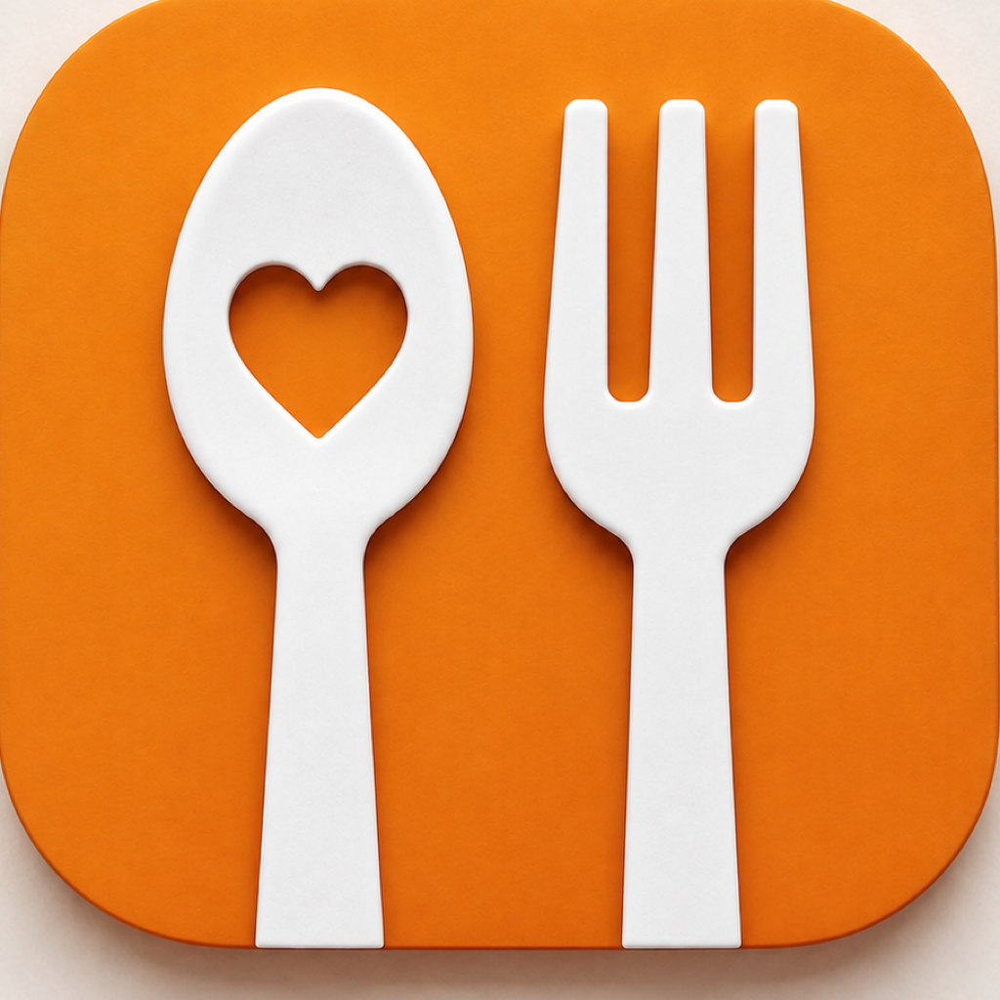
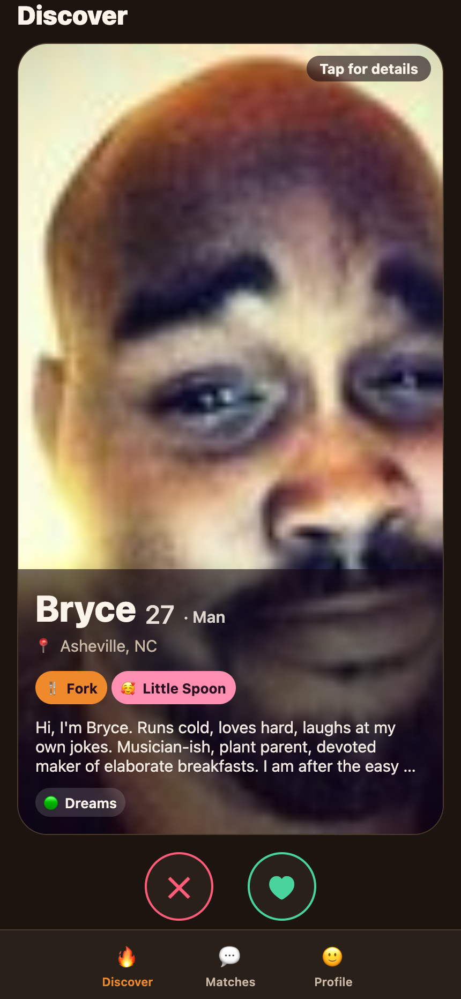
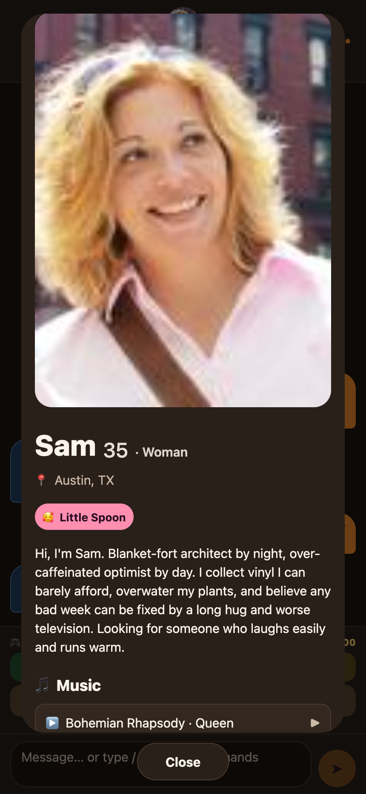
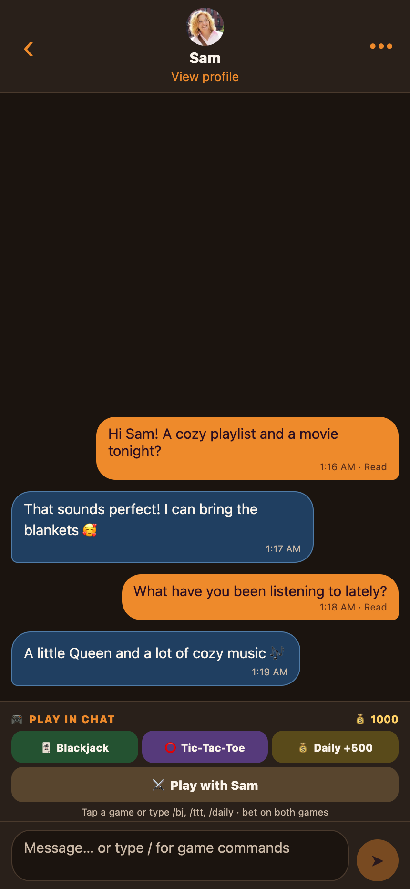
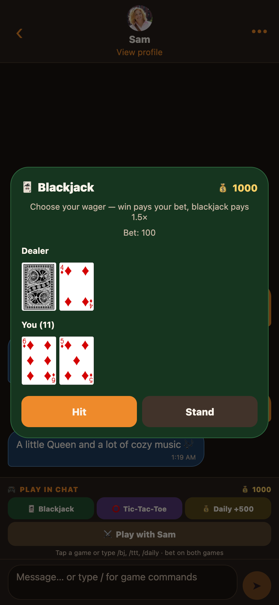

# Cuddle Buddies — Preview

**Swipe. Match. Cuddle.** — a friendly, Tinder-style app for finding cuddle partners.

### 👉 Try the live preview: **[cuddle-buddies.expo.app](https://cuddle-buddies.expo.app)**

🔥 Swipe · 💬 Live chat · 🤖 Demo replies · 🎵 Music player · 🃏 Chat games · 🎨 Themes

> **18+ only.** Cuddle Buddies is an adults-only app. Please don't share the link with anyone under 18.

---

## 💡 What is it?

Cuddle Buddies helps people find others to cuddle with — anything from a cozy, platonic snuggle to something more, entirely up to the two people involved. You pick how you like to cuddle, swipe through people nearby, and when two of you both swipe right, it's a match and you can start chatting.

It works like the dating apps you already know, so there's nothing new to learn.

## 📱 A peek inside

<table>
<tr>
<td align="center"><strong>💘 Discover</strong> </td>
<td align="center"><strong>🫂 Full profiles</strong> </td>
</tr>
<tr>
<td align="center"><strong>💬 Cozy conversations</strong> </td>
<td align="center"><strong>🃏 Play together</strong> </td>
</tr>
</table>

Preview screenshots show demo profiles. Chat and profile examples use isolated sample data.

## 🎮 Games are easy to find

Open any chat and look just above the message box for the always-visible **PLAY
IN CHAT** bar. Tap **⚔️ Play with [name]** to challenge your match, or play a
solo round using **🃏 Blackjack**, **⭕ Tic-Tac-Toe**, or **🎡 Roulette**. The **💰 Daily +500**
button hides once claimed until it's ready again. Your credit balance is shown
right there too.

### ⚔️ Challenge a match

1. Tap **Play with [name]**, choose **Invite [name]**, pick a game and set a bet.
   Wagers can be 1–1,000,000 credits, up to each player's balance.
2. Your match sees the invitation in the same chat and can **accept or decline**.
   Both players stake the same amount only when the invitation is accepted.
3. Take turns live! The winner gets both bets; a draw refunds both. In
   head-to-head Blackjack, the closest hand to 21 without busting wins; both
   busting is a draw, and hands are hidden from each other until the end.
4. Close the game to keep chatting and reopen it later. Forfeiting awards the
   pot to your opponent, or either player can refund both wagers after
   **24 hours without a move**.

🤖 Playing with a demo profile? Choose **Demo bot** to play its automated
opponent, or **Invite [name]** to challenge a friend signed into that account.
The demo bot's stake comes from the demo bank, not that account's balance.

Prefer typing? Start with `/` in the chat box to see command suggestions and
tap one to autocomplete it. You can also send `/blackjack` (or `/bj 50` to set
an initial wager), `/tictactoe` (or `/ttt 50`), `/roulette` (or `/rl 50 red`),
`/daily`, `/credits`, and `/help`.
🎲 **Every solo game is bettable:** Blackjack and Tic-Tac-Toe let you edit the
wager or use ±10 / MAX. Roulette lets you choose a chip value and place chips
on a casino table, with **Undo / Clear** before spinning. Each round's total
stake ranges from **1 to 1,000,000 credits**, up to your available balance;
Roulette's MAX uses the allowance remaining after chips already placed.

## ⏱️ Try it in 2 minutes

1. Open **[cuddle-buddies.expo.app](https://cuddle-buddies.expo.app)** on your phone or computer.
2. **Create an account** (you'll confirm you're 18+), *or* use a demo login below to jump straight in.
3. Swipe, match, and say hi.

📱 This link opens the web preview. Reload it to pick up updates; a separate
Expo Go session does not update automatically when the website is deployed.

**Demo logins** (shared test accounts — no setup needed). Every account uses the same password **`password123`**, and the email is always `<firstname>@example.com`.

A few to get you started:

| Email | Password |
| --- | --- |
| `alex@example.com` | `password123` |
| `sam@example.com` | `password123` |
| `jordan@example.com` | `password123` |

<strong>Show all 250 demo logins</strong> — every account uses the password <code>password123</code>

| Email | Email | Email | Email | Email |
| --- | --- | --- | --- | --- |
| `alex@example.com` | `sam@example.com` | `jordan@example.com` | `taylor@example.com` | `casey@example.com` |
| `riley@example.com` | `morgan@example.com` | `jamie@example.com` | `avery@example.com` | `quinn@example.com` |
| `drew@example.com` | `reese@example.com` | `skyler@example.com` | `parker@example.com` | `rowan@example.com` |
| `emerson@example.com` | `finley@example.com` | `harper@example.com` | `sawyer@example.com` | `dakota@example.com` |
| `hayden@example.com` | `kendall@example.com` | `logan@example.com` | `peyton@example.com` | `blake@example.com` |
| `cameron@example.com` | `charlie@example.com` | `elliot@example.com` | `frankie@example.com` | `jesse@example.com` |
| `kai@example.com` | `lennon@example.com` | `marley@example.com` | `nico@example.com` | `oakley@example.com` |
| `phoenix@example.com` | `river@example.com` | `sage@example.com` | `tatum@example.com` | `wren@example.com` |
| `arden@example.com` | `bellamy@example.com` | `remy@example.com` | `shiloh@example.com` | `sutton@example.com` |
| `teagan@example.com` | `val@example.com` | `ellis@example.com` | `rory@example.com` | `angel@example.com` |
| `ari@example.com` | `aubrey@example.com` | `bailey@example.com` | `billie@example.com` | `briar@example.com` |
| `brook@example.com` | `carson@example.com` | `clarke@example.com` | `dallas@example.com` | `dana@example.com` |
| `denver@example.com` | `devon@example.com` | `eden@example.com` | `elliott@example.com` | `emery@example.com` |
| `fallon@example.com` | `flynn@example.com` | `gray@example.com` | `greer@example.com` | `hollis@example.com` |
| `indigo@example.com` | `ira@example.com` | `isa@example.com` | `jai@example.com` | `jules@example.com` |
| `juno@example.com` | `kieran@example.com` | `lake@example.com` | `lane@example.com` | `lennox@example.com` |
| `louis@example.com` | `linden@example.com` | `london@example.com` | `lor@example.com` | `lux@example.com` |
| `lyric@example.com` | `marlowe@example.com` | `micah@example.com` | `monroe@example.com` | `noa@example.com` |
| `nova@example.com` | `oakes@example.com` | `ocean@example.com` | `onyx@example.com` | `ozzy@example.com` |
| `paris@example.com` | `pax@example.com` | `perry@example.com` | `presley@example.com` | `rain@example.com` |
| `ray@example.com` | `rhodes@example.com` | `robin@example.com` | `ronnie@example.com` | `rumi@example.com` |
| `sacha@example.com` | `salem@example.com` | `sasha@example.com` | `scout@example.com` | `seb@example.com` |
| `sky@example.com` | `sloan@example.com` | `sol@example.com` | `sonny@example.com` | `spencer@example.com` |
| `story@example.com` | `sunny@example.com` | `sydney@example.com` | `tanner@example.com` | `tegan@example.com` |
| `toby@example.com` | `tory@example.com` | `true@example.com` | `tyler@example.com` | `vesper@example.com` |
| `wilder@example.com` | `winter@example.com` | `wynn@example.com` | `yael@example.com` | `zephyr@example.com` |
| `zion@example.com` | `ash@example.com` | `aspen@example.com` | `august@example.com` | `bay@example.com` |
| `beau@example.com` | `blair@example.com` | `bowie@example.com` | `cade@example.com` | `campbell@example.com` |
| `caspian@example.com` | `chandler@example.com` | `cleo@example.com` | `cody@example.com` | `cole@example.com` |
| `collins@example.com` | `cove@example.com` | `cruz@example.com` | `darby@example.com` | `dell@example.com` |
| `dove@example.com` | `dylan@example.com` | `echo@example.com` | `ellery@example.com` | `evan@example.com` |
| `everest@example.com` | `ever@example.com` | `fable@example.com` | `fox@example.com` | `gael@example.com` |
| `gable@example.com` | `gentry@example.com` | `hale@example.com` | `harlow@example.com` | `haven@example.com` |
| `idris@example.com` | `ike@example.com` | `isla@example.com` | `jade@example.com` | `jem@example.com` |
| `jett@example.com` | `joey@example.com` | `jovie@example.com` | `kit@example.com` | `koa@example.com` |
| `kyrie@example.com` | `landry@example.com` | `lennan@example.com` | `levi@example.com` | `lior@example.com` |
| `lonnie@example.com` | `loren@example.com` | `mac@example.com` | `marlo@example.com` | `maxen@example.com` |
| `mika@example.com` | `milan@example.com` | `nalo@example.com` | `nell@example.com` | `nixon@example.com` |
| `nolan@example.com` | `north@example.com` | `oak@example.com` | `odell@example.com` | `ollie@example.com` |
| `orion@example.com` | `otis@example.com` | `pace@example.com` | `palmer@example.com` | `pat@example.com` |
| `pell@example.com` | `quill@example.com` | `raine@example.com` | `reed@example.com` | `reign@example.com` |
| `ren@example.com` | `rene@example.com` | `rio@example.com` | `roan@example.com` | `rome@example.com` |
| `roscoe@example.com` | `ross@example.com` | `sable@example.com` | `sayer@example.com` | `shae@example.com` |
| `shay@example.com` | `sidney@example.com` | `skye@example.com` | `stevie@example.com` | `tam@example.com` |
| `tao@example.com` | `tate@example.com` | `tennyson@example.com` | `theo@example.com` | `tobin@example.com` |
| `tru@example.com` | `vale@example.com` | `vince@example.com` | `wade@example.com` | `wells@example.com` |
| `west@example.com` | `will@example.com` | `wynne@example.com` | `yuki@example.com` | `zane@example.com` |
| `zara@example.com` | `zuri@example.com` | `adair@example.com` | `alby@example.com` | `alder@example.com` |
| `ames@example.com` | `arlo@example.com` | `auden@example.com` | `bader@example.com` | `baylor@example.com` |
| `berk@example.com` | `blaise@example.com` | `blue@example.com` | `branch@example.com` | `bryce@example.com` |

> Tip: open it in two different browsers (or a normal + private window) with two different demo accounts to see a match and live chat happen in real time.
> 🧹 **Shared preview:** chat history, matches, and swipe history may be reset
> during testing; demo logins remain available.
> 🤖 To chat, just **like any profile** — demo profiles like you back instantly,
> so you get a match and an auto-reply right away with a single login.

## ✨ What to try

- **Sign up** — set your **gender** and who you're **interested in**, then choose your cuddle style: **🫂 Big Spoon**, **🥰 Little Spoon**, **🍴 Fork** (Fork = open to adult relations), or **🥄 Spork** (Spork = open to a threesome). You can pick more than one — an on-screen **key explains what each one means**.
- **Fix your details** — in **Profile** you can edit your **birthdate** 🎂 (if your age looks wrong) and add **unlimited songs** 🎵 (Spotify / Apple Music / YouTube), which play in an in-app player.
- **Set who you want to see** — change **Show me**, **Your gender**, or
  **Interested in** on your Profile. Discover refreshes when you return and
  waits for your changes to save. Mutual interests and cuddle style also narrow
  the feed; older profiles without a gender or stated interests may still appear.
- **Swipe** — right (or tap ♥) to cuddle, left (or tap ✕) to pass. On a computer, drag the cards with your mouse.
- **Not sure? Swipe up for Maybe** 🤔 — swipe up (or tap **?**), choose
  **1–5 days**, and that person leaves your deck until then. They come back at
  the front of your feed, tagged **Back from Maybe**, so you can decide again.
  Canceling the picker keeps the card. A Maybe never counts as a
  like, so it can't create a match on its own.
- **Match & chat** — mutual likes create a match (demo profiles like you back
  instantly). Your messages are **orange**;
  replies are **blue**. Messages resync after reconnect or returning to the app.
- **Play together** — the prominent **PLAY IN CHAT** bar sits above the
  composer in every conversation. Challenge your match to live Blackjack or
  Tic-Tac-Toe, choose a demo bot, or use the solo Blackjack, Tic-Tac-Toe,
  Roulette, and Daily Bonus buttons. Typing `/` also autocompletes available commands.
- **Open their profile** — tap a Discover card, a Matches avatar, or the chat
  header's avatar/name to see photos, full bio, cuddle styles, and music.
- **Share your profile** — on the **Profile** tab, tap **🔗 Share profile** to
  copy a public link (e.g. `cuddle-buddies.expo.app/u/<you>`). Anyone can open it
  to view the profile — shown in **your chosen theme & app icon** 🎨 and with a rich
  social-media preview — but they must **sign up** before they can like or message.
- **Send faster** — **Enter sends**; desktop **Shift+Enter** makes a newline.
  Phone keyboard Return sends too.
- **Unsend** — tap the visible **Unsend** action or long-press your own unread
  message, then confirm. Read messages cannot be unsent.
- **Chat controls** — tap **⋯** to view profile, unmatch, block, or report.
- 🤖 **Chat with real AI — free** — every demo (seed) profile replies **in
  character with a real AI model**, at no cost: when no paid AI credits are
  available the app uses the free [Pollinations](https://pollinations.ai) LLM
  (no key needed). Like a demo profile → instant match → say hi and get an AI
  reply in a few seconds. Ask for a **selfie/pic** to get their photo. If the
  free service is ever down, a short scripted reply is used instead.
- **Your profile** — edit your name, bio, city, add photos, and update your cuddle styles anytime.
- **Share your music taste** — add **Spotify, Apple Music, or YouTube** song links to your profile (Profile → *Music I love*). When you and someone you're viewing both like the same track, it's **starred** on their card. Demo accounts already have a few songs, so you'll see matches right away.
- **Make it yours** — in **Profile → App icon & theme**, pick a look (**Classic**, **Sorbet**, **Noir**, **Blush**, or **Neon**). It swaps the app logo and re-colors the whole app, and your pick is saved to your account — so it follows you the next time you log in. Classic is the default.
- **Music player** — open a profile and tap **▶** beside a song for the integrated
  player. Provider availability, embeds, and playback restrictions may vary.

## 🃏 Mini-games & play credits

Use the always-visible game buttons above the chat composer, or type `/` to
autocomplete a command. Sending a command works too:

| Command | What happens |
| --- | --- |
| `/bj`, `/blackjack`, or `/bj 50` | Solo Blackjack against the dealer, with card images, **Hit / Stand**, and adjustable wagers |
| `/ttt`, `/tictactoe`, or `/ttt 50` | Solo Tic-Tac-Toe against a bot with a responsive board and adjustable wagers — a win pays **2× your bet**, a draw refunds it, a loss loses it |
| `/rl`, `/roulette`, or `/rl 50 red` | Solo single-zero Roulette with a spinning wheel and casino table. Place chips on several numbers or outside bets: 🔴 Red / ⚫ Black, Odd / Even, 1–18 / 19–36 (**2×**), dozens or columns (**3×**), or numbers 0–36 (**36×**, stake included). Commands can preplace a pick such as `red`, `odd`, `2nd`, `col2`, or `17`; otherwise the table starts empty. All bets settle against one server-selected pocket |
| `/daily` | Claim **500 credits** once every **20 hours** — the Daily button hides after you claim it |
| `/credits` or `/balance` | Check your current balance from the server |
| `/help` | List the game commands |

For Roulette, choose a **1/5/25/100/500-credit chip**, type a custom value, or
tap **MAX**, then tap the table. Repeated taps stack chips; **Undo** removes the
last chip and **Clear** removes all bets. Swipe the table sideways on phones.
Tap **Spin** and watch the wheel land on the server's result. The green 0 loses
every outside bet. Closing Roulette does not cancel a submitted spin.

New accounts begin with **1,000 play credits**. These are just for fun,
have no cash value, and are unrelated to AI provider billing. Wager controls
are shown before each game. Closing **solo** Tic-Tac-Toe mid-round forfeits its
bet; closing a **multiplayer** game leaves it available to resume. Blocking or
unmatching refunds any active multiplayer bets.

## 🌱 Good to know — this is an early preview

- It's a **mobile app**. On a computer it's shown inside a phone frame so it looks and feels right; on a phone it's full-screen.
- It's a **demo environment** — be kind, and note that test data may be reset from time to time.
- Demo portraits are **placeholder photos**, not verified real members or
  guaranteed AI-generated people. Shared logins are public: don't enter private information.
- If an old screen is still showing, reload; if necessary clear this site's
  stored data/cache and sign in again. A chat error banner means connectivity
  needs attention rather than simply waiting for a reply.
- A few things are still being polished, so if something feels rough, that's expected — your feedback helps!

## 💌 Share your feedback

We'd love your thoughts — what felt good, what was confusing, what you'd want next.

- **Open an issue** right here → the **[Issues](../../issues)** tab, or
- Send your notes directly to the person who shared this with you.

---

Be kind, be safe, cuddle responsibly. 🧡

